# **_Práctica 1_**

## Implementaciond de una red LAN para un edificio de 3 pisos

### 2do Semestre del 2025

```js
Universidad San Carlos de Guatemala
Programador: César Rolando Hernández Palacios
Carne: 202000806
Correo: cesarhernandez0019@gmail.com
```

---

## **_Manual Tecnico_**

#### **IP Utilizadas**

| Dirección Ip |
| :----------: |
| 192.168.6.1  |
| 192.168.6.2  |
| 192.168.6.3  |
| 192.168.6.4  |
| 192.168.6.5  |
| 192.168.6.6  |
| 192.168.6.7  |
| 192.168.6.8  |
| 192.168.6.9  |
| 192.168.6.10 |
| 192.168.6.11 |
| 192.168.6.12 |
| 192.168.6.13 |
| 192.168.6.14 |
| 192.168.6.15 |
| 192.168.6.16 |
| 192.168.6.17 |
| 192.168.6.18 |
| 192.168.6.19 |
| 192.168.6.20 |
| 192.168.6.21 |
| 192.168.6.22 |
| 192.168.6.23 |
| 192.168.6.24 |
| 192.168.6.25 |
| 192.168.6.26 |
| 192.168.6.27 |
| 192.168.6.28 |
| 192.168.6.29 |
| 192.168.6.30 |
| 192.168.6.31 |
| 192.168.6.32 |
| 192.168.6.33 |
| 192.168.6.34 |
| 192.168.6.35 |
| 192.168.6.36 |
| 192.168.6.37 |
| 192.168.6.38 |
| 192.168.6.39 |
| 192.168.6.40 |
| 192.168.6.41 |
| 192.168.6.42 |
| 192.168.6.43 |
| 192.168.6.44 |
| 192.168.6.45 |
| 192.168.6.46 |
| 192.168.6.47 |
| 192.168.6.48 |
| 192.168.6.49 |
| 192.168.6.50 |
| 192.168.6.51 |
| 192.168.6.52 |
| 192.168.6.53 |
| 192.168.6.54 |
| 192.168.6.55 |
| 192.168.6.56 |
| 192.168.6.57 |
| 192.168.6.58 |
| 192.168.6.59 |
| 192.168.6.60 |

#### **Comandos para configurar switch**

1.  Para entrar al modo configuracion global o modo previlegeado

        enable

2.  Para entrar en modo de configuracion de terminal ya estando en modo global

        configure terminal

3.  Para cambiar el nombre de un swich

        hostname nombreAsignar

4.  Para guardar los cambios realizados desde la terminal pero solo en modo global

        copy running-config startup-config

5.  Para cambiar la contraseña para entrar al switch estando en modo configuracion de terminal

        line console 0
        password ConstraseñaAsignar
        login

#### **VPCs**

1.  Recepcion

    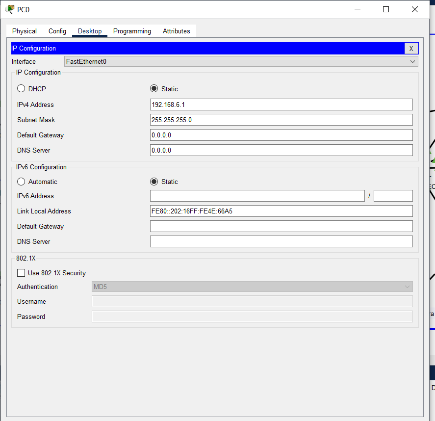

2.  Contabilidad

    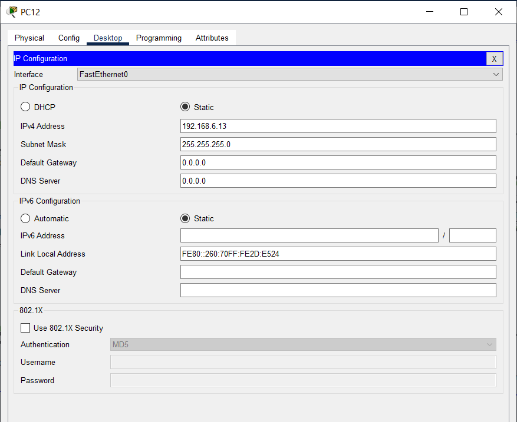

3.  Reuniones

    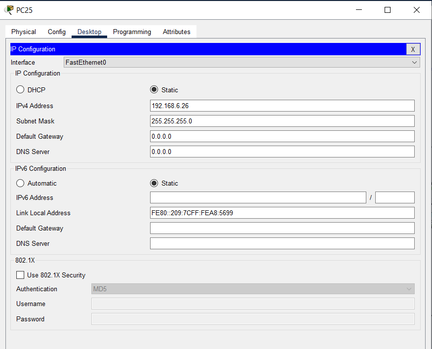

4.  Legal

    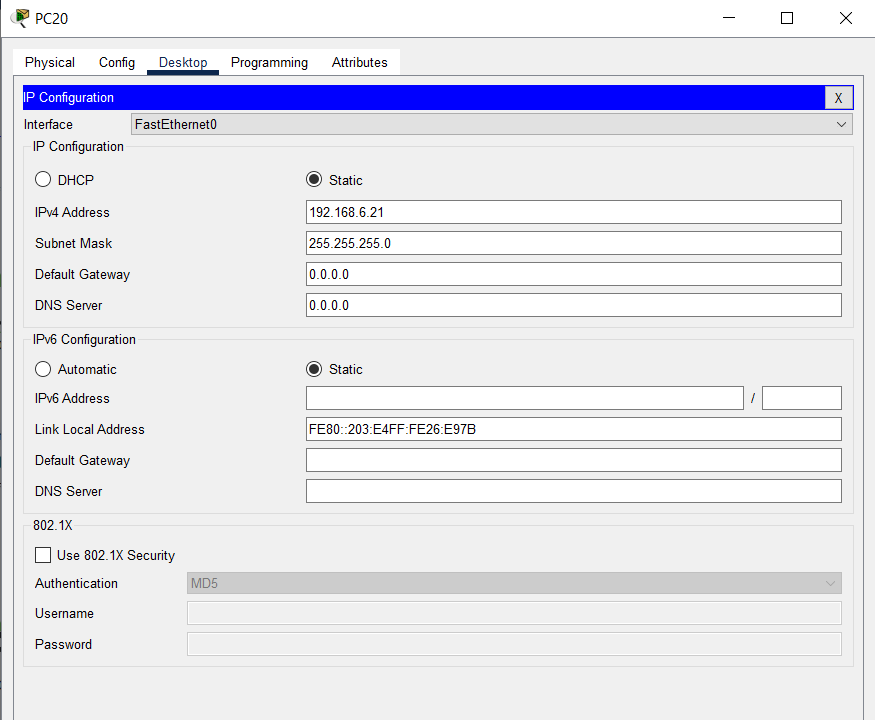

5.  Arquitectura

    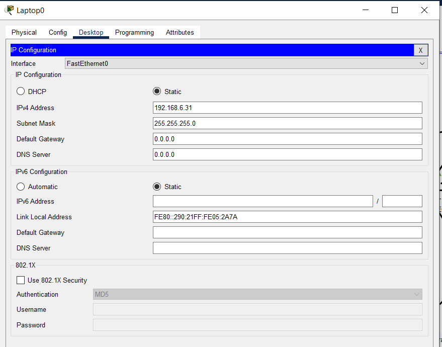

6.  Revicion de planos

    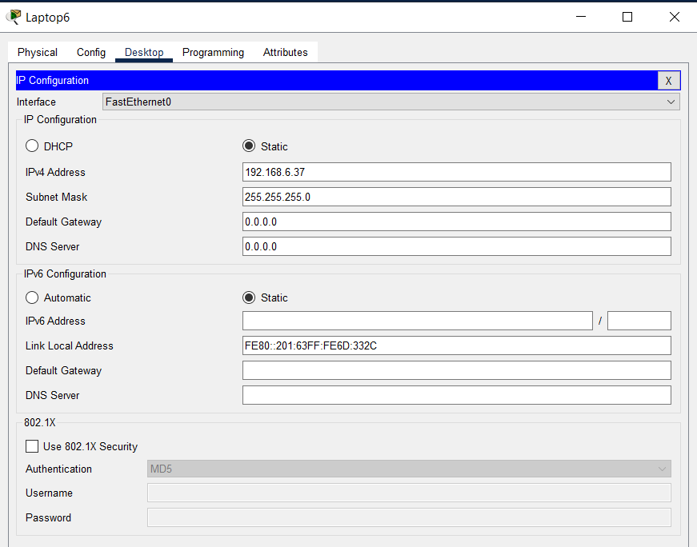

7.  Urbanismo

    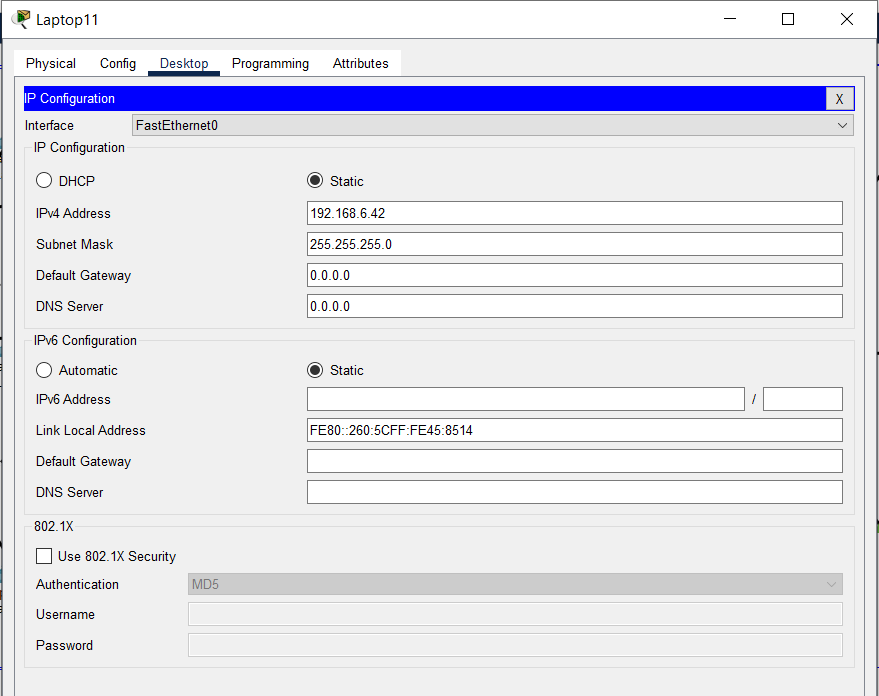

8.  Direccion general

    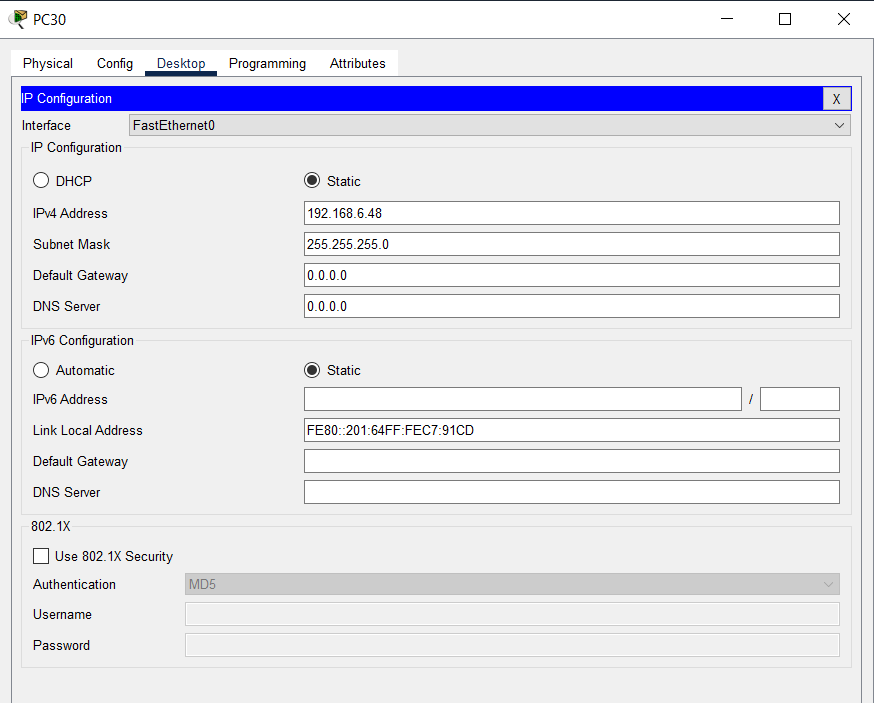

9.  Servidores principales

    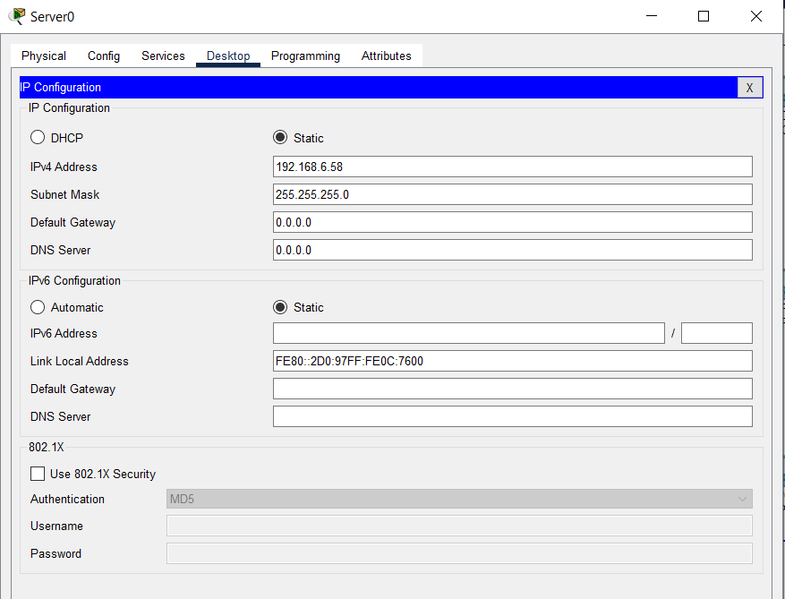

10. Ingenieria civil

    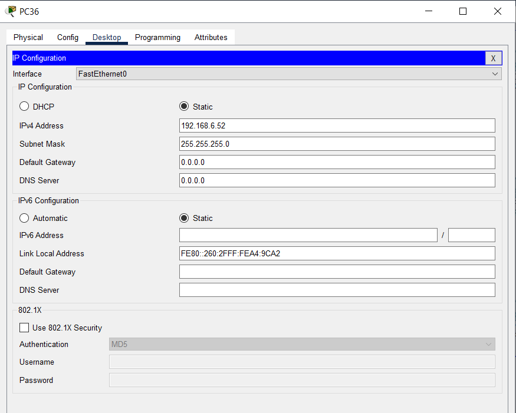

#### **Ping entre host**

1.  De recepcion a contabilidad

    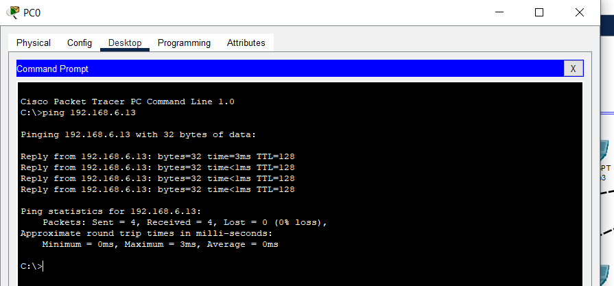

2.  De contabilidad a Reuniones

    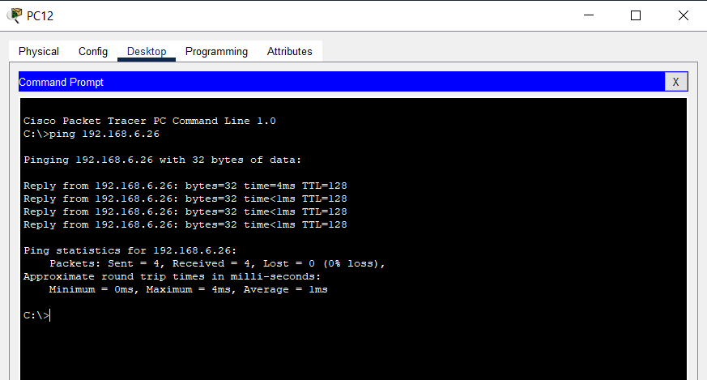

3.  De reuniones a legal

    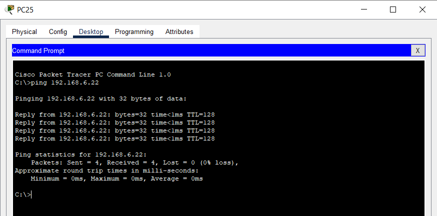

4.  De legal a arquitectura

    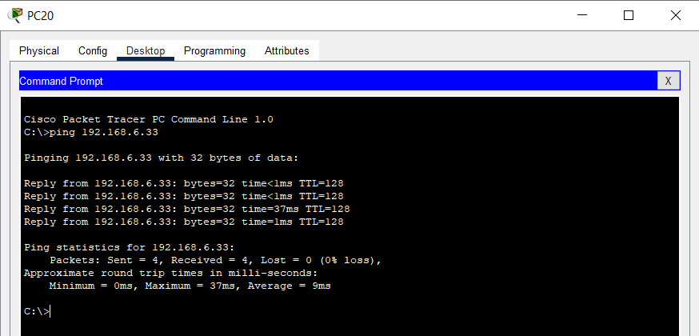

5.  De arquitectura a revicion de planos

    

6.  De revision de planos a urbanismo

    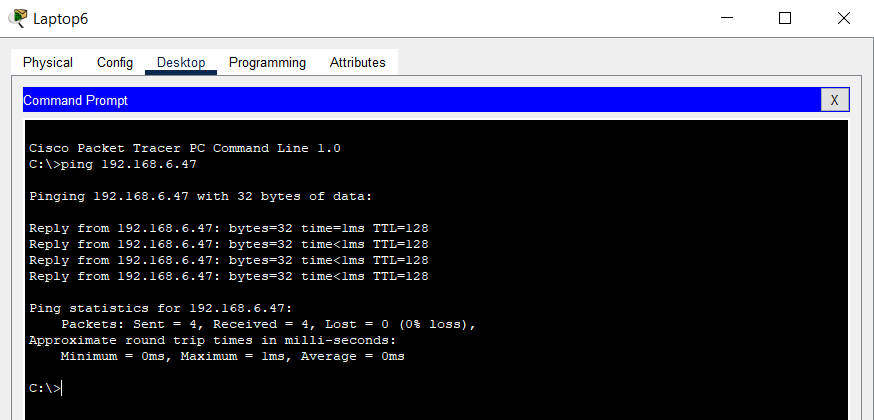

7.  De urbanismo a Direccione general

    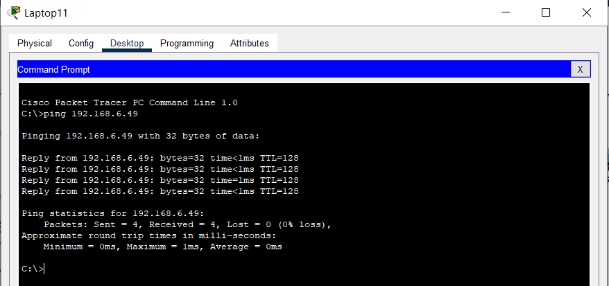

8.  De Direccion general a servidores principales

    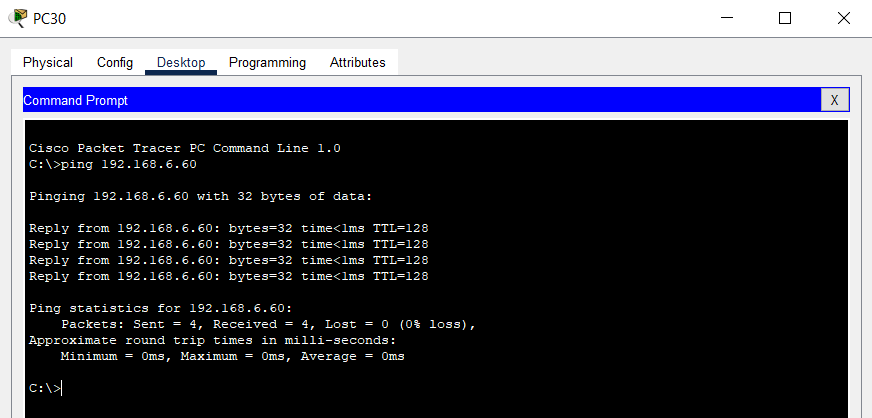

9.  De servidores principales a ingenieria civil

    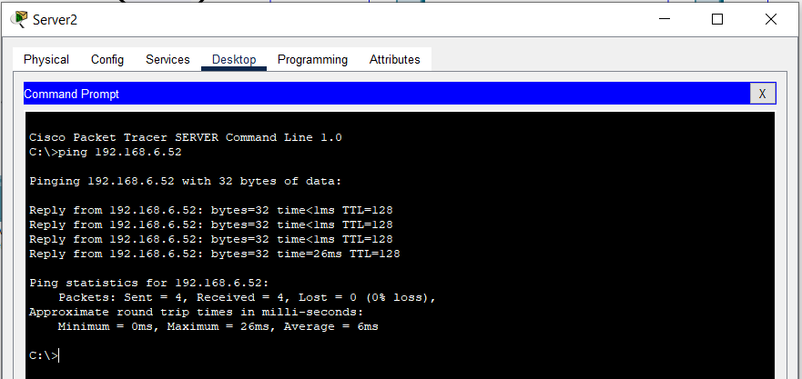

10. De ingenieria civil a recepcion

    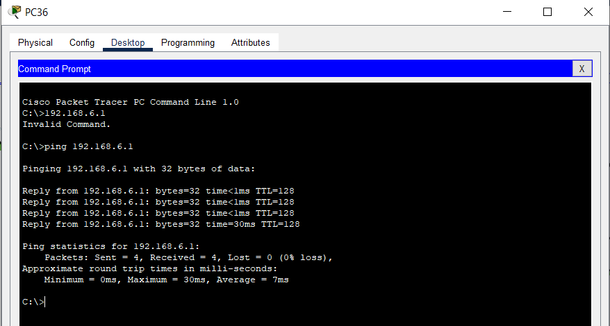

#### **Demostracion de paquetes ARP Y ICMP**

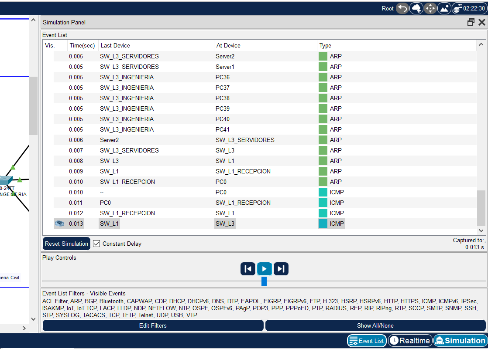
