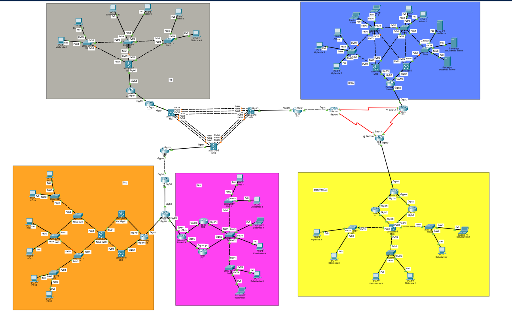
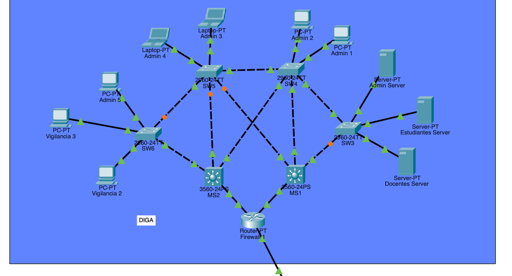
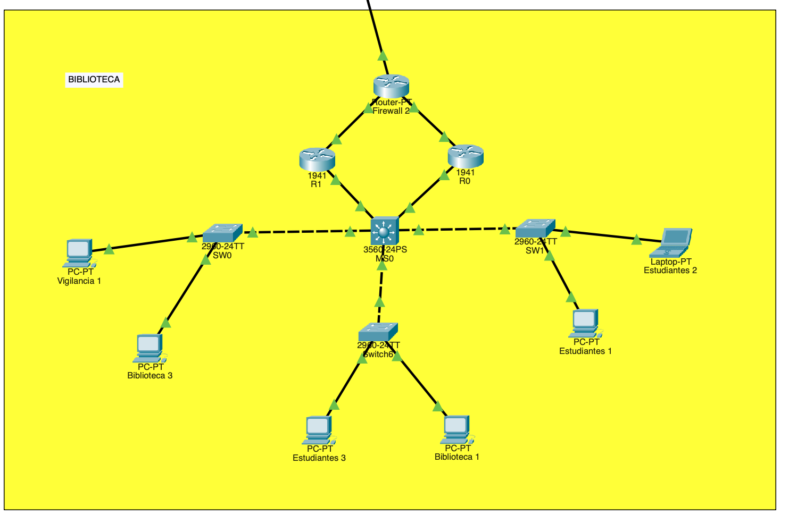
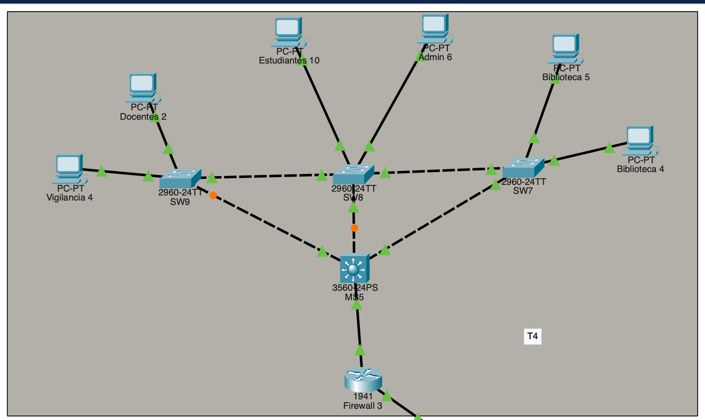
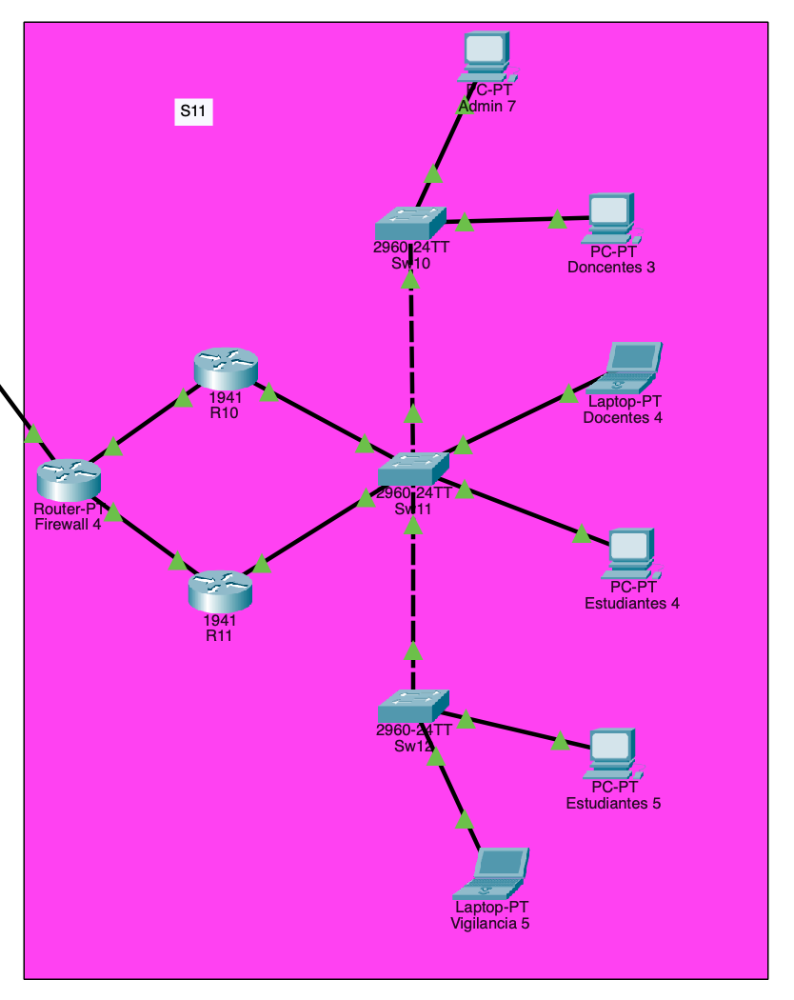
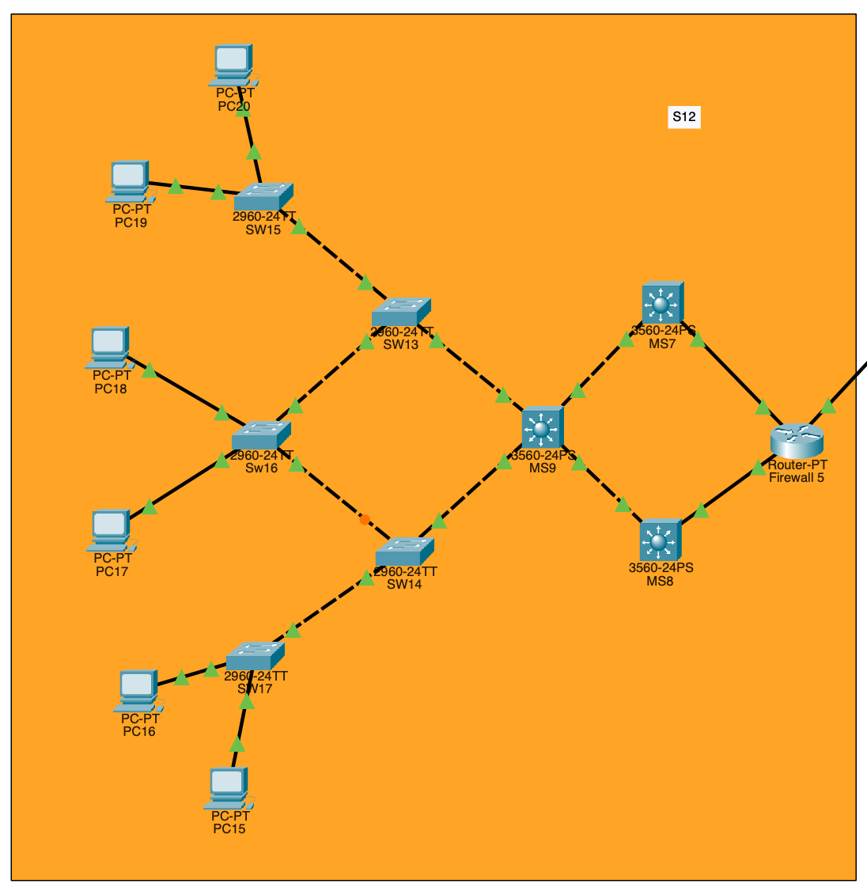
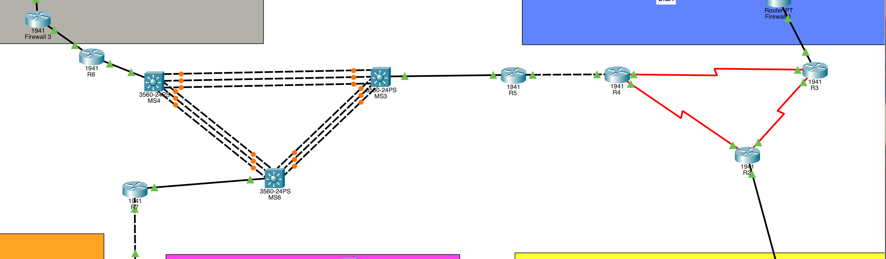

# **_Proyecto 2_**

## NetUSAC: Proyecto de Interconexión

### 2do Semestre del 2025

```js
Universidad San Carlos de Guatemala
Programador: César Rolando Hernández Palacios
Carne: 202000806
Correo: cesarhernandez0019@gmail.com
```

---

# **_Manual Tecnico_**

## **Implementacion de topologia**

Topologia completa



Implementacion de la topologia del area DIGA



Implementacion de la topologia del area de Biblioteca



Implementacion de la topologia del area del T4



Implementacion de la topologia del area del S11


Implementacion de la topologia del area del S12



Implementacion de la topologia del area del backbone



---

## **Comfiguraciones Implementadas**

### Configuración VLANs:

    - VLAN 16: Estudiantes
    - VLAN 26: Docentes
    - VLAN 36: Vigilancia
    - VLAN 46: Admin
    - VLAN 56: Biblioteca

### **DIGA**

1.  SW5

    ##### Comandos de configuracion:

        en
        configure terminal
        hostname SW5

        ! Configurar VTP
        vtp domain 202000806
        vtp password usac2025
        vtp mode server

        ! Crear VLANs
        vlan 16
        name ESTUDIANTES
        exit

        vlan 26
        name DOCENTES
        exit

        vlan 36
        name VIGILANCIA
        exit

        vlan 46
        name ADMIN
        exit

        ! Configurar trunk
        interface range fastEthernet 0/1 - 4
        switchport mode trunk
        switchport trunk allowed vlan 16,26,36,46
        no shutdown
        exit

        ! Configurar access
        interface range fastEthernet 0/5 - 6
        switchport mode access
        switchport access vlan 46


        end
        write memory

2.  SW6

    ##### Comandos de configuracion:

        enable
        configure terminal
        hostname SW6

        ! Configurar VTP
        vtp domain 202000806
        vtp password usac2025
        vtp mode client

        ! Configurar trunk
        interface range fastEthernet 0/1 - 2
        switchport mode trunk
        switchport trunk allowed vlan 16,26,36,46
        no shutdown
        exit

        ! Configurar access
        interface range fastEthernet 0/3 - 4
        switchport mode access
        switchport access vlan 36

        interface  fastEthernet 0/5
        switchport mode access
        switchport access vlan 46

        end
        write memory

3.  SW4

    ##### Comandos de configuracion:

        enable
        configure terminal
        hostname SW4

        ! Configurar VTP
        vtp domain 202000806
        vtp password usac2025
        vtp mode client

        ! Configurar trunk
        interface range fastEthernet 0/1 - 4
        switchport mode trunk
        switchport trunk allowed vlan 16,26,36,46
        no shutdown
        exit

        ! Configurar access
        interface range fastEthernet 0/5 - 6
        switchport mode access
        switchport access vlan 46

        end
        write memory

4.  SW3

    ##### Comandos de configuracion:

        enable
        configure terminal
        hostname SW3

        ! Configurar VTP
        vtp domain 202000806
        vtp password usac2025
        vtp mode client

        ! Configurar trunk
        interface range fastEthernet 0/1 - 2
        switchport mode trunk
        switchport trunk allowed vlan 16,26,36,46
        no shutdown
        exit

        ! Configurar access
        interface  fastEthernet 0/3
        switchport mode access
        switchport access vlan 46

        interface  fastEthernet 0/4
        switchport mode access
        switchport access vlan 16

        interface  fastEthernet 0/5
        switchport mode access
        switchport access vlan 26


        end
        write memory

5.  MS1

    ##### Comandos de configuracion:

        enable
        configure terminal
        hostname MS1

        ! Habilitar enrutamiento IP
        ip routing

        ! Configurar VTP
        vtp domain 202000806
        vtp password usac2025
        vtp mode client

        ! Crear VLANs (se propagan desde SW5)
        ! Las VLANs ya existen por VTP

        ! Configurar trunk
        interface range fastEthernet 0/2 - 4
        switchport trunk encapsulation dot1q
        switchport mode trunk
        switchport trunk allowed vlan 16,26,36,46
        no shutdown
        exit

        ! Configurar trunk
        interface gigabitEthernet 0/1
        no switchport
        ip address 10.0.0.78 255.255.255.252
        no shutdown
        exit

        ! HSRP por VLAN
        interface vlan 16
        ip address 192.168.6.161 255.255.255.248
        standby 1 ip 192.168.6.163
        standby 1 priority 110
        standby 1 preempt
        no shutdown
        exit

        interface vlan 26
        ip address 192.168.6.169 255.255.255.248
        standby 1 ip 192.168.6.171
        standby 1 priority 110
        standby 1 preempt
        no shutdown
        exit

        interface vlan 36
        ip address 192.168.6.129 255.255.255.224
        standby 1 ip 192.168.6.131
        standby 1 priority 110
        standby 1 preempt
        no shutdown
        exit

        interface vlan 46
        ip address 192.168.6.1 255.255.255.128
        standby 1 ip 192.168.6.3
        standby 1 priority 110
        standby 1 preempt
        no shutdown
        exit

        end
        write memory

6.  MS2

    ##### Comandos de configuracion:

        enable
        configure terminal
        hostname MS2

        ! Habilitar enrutamiento IP
        ip routing

        ! Configurar VTP
        vtp domain 202000806
        vtp password usac2025
        vtp mode client

        ! Crear VLANs (se propagan desde SW5)
        ! Las VLANs ya existen por VTP

        ! Configurar trunk
        interface range fastEthernet 0/2 - 4
        switchport trunk encapsulation dot1q
        switchport mode trunk
        switchport trunk allowed vlan 16,26,36,46
        no shutdown
        exit

        ! Configurar trunk
        interface gigabitEthernet 0/1
        no switchport
        ip address 10.0.0.74 255.255.255.252
        no shutdown
        exit

        ! HSRP por VLAN
        interface vlan 16
        ip address 192.168.6.162 255.255.255.248
        standby 1 ip 192.168.6.163
        standby 1 priority 100
        standby 1 preempt
        no shutdown
        exit

        interface vlan 26
        ip address 192.168.6.170 255.255.255.248
        standby 1 ip 192.168.6.171
        standby 1 priority 100
        standby 1 preempt
        no shutdown
        exit

        interface vlan 36
        ip address 192.168.6.130 255.255.255.224
        standby 1 ip 192.168.6.131
        standby 1 priority 100
        standby 1 preempt
        no shutdown
        exit

        interface vlan 46
        ip address 192.168.6.2 255.255.255.128
        standby 1 ip 192.168.6.3
        standby 1 priority 100
        standby 1 preempt
        no shutdown
        exit

        end
        write memory

### **Biblioteca**

1.  MS0

    ##### Comandos de configuracion:

        enable
        configure terminal
        hostname MS0


        ! Configurar VTP
        vtp domain 202000806
        vtp password usac2025
        vtp mode server


        ! Crear VLANs
        vlan 16
        name ESTUDIANTES
        exit

        vlan 36
        name VIGILANCIA
        exit

        vlan 56
        name BIBLIOTECA
        exit


        ! Configurar trunk  puertos giga
        interface range gigabitEthernet 0/1-2
        switchport trunk encapsulation dot1q
        switchport mode trunk
        switchport trunk allowed vlan 16,36,56
        no shutdown
        exit

        ! Configurar trunk puertos fast
        interface range fastEthernet 0/1 - 3
        switchport trunk encapsulation dot1q
        switchport mode trunk
        switchport trunk allowed vlan 16,36,56
        no shutdown
        exit

2.  SW0

    ##### Comandos de configuracion:

        enable
        configure terminal
        hostname SW0

        ! Configurar VTP
        vtp domain 202000806
        vtp password usac2025
        vtp mode client

        ! Configurar trunk
        interface fastEthernet 0/1
        switchport mode trunk
        switchport trunk allowed vlan 16,36,56
        no shutdown
        exit

        ! Configurar access
        interface  fastEthernet 0/2
        switchport mode access
        switchport access vlan 36

        interface  fastEthernet 0/3
        switchport mode access
        switchport access vlan 56


        end
        write memory

3.  SW1

    ##### Comandos de configuracion:

        enable
        configure terminal
        hostname SW1

        ! Configurar VTP
        vtp domain 202000806
        vtp password usac2025
        vtp mode client

        ! Configurar trunk puertos fast
        interface fastEthernet 0/1
        switchport mode trunk
        switchport trunk allowed vlan 16,36,56
        no shutdown
        exit

        ! Configurar access
        interface range fastEthernet 0/5 - 6
        switchport mode access
        switchport access vlan 46

        end
        write memory

4.  SWITCH6

    ##### Comandos de configuracion:

        enable
        configure terminal
        hostname switch6

        ! Configurar VTP
        vtp domain 202000806
        vtp password usac2025
        vtp mode client

        ! Configurar trunk puertos fast
        interface range fastEthernet 0/1-3
        switchport mode trunk
        switchport trunk allowed vlan 16,36,56
        no shutdown
        exit

        ! Configurar access
        interface fastEthernet 0/2
        switchport mode access
        switchport access vlan 16

        interface fastEthernet 0/3
        switchport mode access
        switchport access vlan 56


        end
        write memory

5.  R0

    ##### Comandos de configuracion:

        enable
        configure terminal
        hostname R0

        ! Habilitar enrutamiento IP
        ip routing

        ! Activa las interfaces físicas
        interface gigabitEthernet0/1
        no shutdown
        exit

        ! Configura subinterfaces en los routers con VRRP
        ! Subinterfaces VLAN 16
        interface gigabitEthernet0/0.16
        encapsulation dot1Q 16
        ip address 192.158.6.2 255.255.255.128
        vrrp 16 ip 192.158.6.1
        vrrp 16 priority 110
        vrrp 16 preempt
        exit


        ! Subinterfaces VLAN 36
        interface gigabitEthernet0/0.36
        encapsulation dot1Q 36
        ip address 192.158.6.130 255.255.255.224
        vrrp 36 ip 192.158.6.129
        vrrp 36 priority 110
        vrrp 36 preempt
        exit

        ! Subinterfaces VLAN 56
        interface gigabitEthernet0/0.56
        encapsulation dot1Q 56
        ip address 192.158.6.162 255.255.255.224
        vrrp 56 ip 192.158.6.161
        vrrp 56 priority 110
        vrrp 56 preempt
        exit

        ! confuguracion de subnetin FLSM
        ! Conexión a Firewall 2
        interface gigabitEthernet 0/0
        ip address 10.0.0.82 255.255.255.252
        no shutdown
        exit

6.  R1

    ##### Comandos de configuracion:

        enable
        configure terminal
        hostname R1

        ! Habilitar enrutamiento IP
        ip routing

        ! Activa la interfaz física principal
        interface gigabitEthernet0/1
        no shutdown
        exit

        ! Configura subinterfaces en los routers con VRRP
        ! Subinterfaces VLAN 16
        interface gigabitEthernet0/0.16
        encapsulation dot1Q 16
        ip address 192.158.6.3 255.255.255.128
        vrrp 16 ip 192.158.6.1
        vrrp 16 priority 100
        vrrp 16 preempt
        exit


        ! Subinterfaces VLAN 36
        interface gigabitEthernet0/0.36
        encapsulation dot1Q 36
        ip address 192.158.6.131 255.255.255.224
        vrrp 36 ip 192.158.6.129
        vrrp 36 priority 110
        vrrp 36 preempt
        exit

        ! Subinterfaces VLAN 56
        interface gigabitEthernet0/0.56
        encapsulation dot1Q 56
        ip address 192.158.6.163 255.255.255.224
        vrrp 56 ip 192.158.6.161
        vrrp 56 priority 100
        vrrp 56 preempt
        exit

        ! confuguracion de subnetin FLSM
        ! Conexión a Firewall 2
        interface gigabitEthernet 0/0
        ip address 10.0.0.82 255.255.255.252
        no shutdown
        exit

### **T4**

1.  SW8

    ##### Comandos de configuracion:

        enable
        configure terminal
        hostname SW8


        ! Configurar VTP
        vtp domain 202000806
        vtp password usac2025
        vtp mode server


        ! Crear VLANs
        vlan 16
        name ESTUDIANTES
        exit

        vlan 26
        name DOCENTES
        exit

        vlan 36
        name VIGILANCIA
        exit

        vlan 46
        name ADMIN
        exit

        vlan 56
        name BIBLIOTECA
        exit


        ! Configurar trunk puertos fast
        interface range fastEthernet 0/1 - 3
        switchport mode trunk
        switchport trunk allowed vlan 16,26,36,46,56
        no shutdown
        exit

        ! Configurar access
        interface  fastEthernet 0/4
        switchport mode access
        switchport access vlan 16

        interface  fastEthernet 0/5
        switchport mode access
        switchport access vlan 46

        end
        write memory

2.  SW9

    ##### Comandos de configuracion:

        enable
        configure terminal
        hostname SW9

        ! Configurar VTP
        vtp domain 202000806
        vtp password usac2025
        vtp mode client

        ! Configurar trunk puertos fast
        interface range fastEthernet 0/1-2
        switchport mode trunk
        switchport trunk allowed vlan 16,26,36,46,56
        no shutdown
        exit

        ! Configurar access
        interface  fastEthernet 0/3
        switchport mode access
        switchport access vlan 36

        interface  fastEthernet 0/4
        switchport mode access
        switchport access vlan 26

        end
        write memory

3.  SW7

    ##### Comandos de configuracion:

        enable
        configure terminal
        hostname SW7

        ! Configurar VTP
        vtp domain 202000806
        vtp password usac2025
        vtp mode client

        ! Configurar trunk puertos fast
        interface range fastEthernet 0/1-2
        switchport mode trunk
        switchport trunk allowed vlan 16,26,36,46,56
        no shutdown
        exit

        ! Configurar access
        interface range fastEthernet 0/3 - 4
        switchport mode access
        switchport access vlan 56

        end
        write memory

4.  MS5

    ##### Comandos de configuracion:

        enable
        configure terminal
        hostname MS5

        ! Configurar VTP
        vtp domain 202000806
        vtp password usac2025
        vtp mode client

        ! Configurar trunk puertos fast
        interface range fastEthernet 0/1-3
        switchport trunk encapsulation dot1q
        switchport mode trunk
        switchport trunk allowed vlan 16,26,36,46,56
        no shutdown
        exit

        ! Configurar SVI para VLAN 16 - Estudiantes
        interface vlan 16
        ip address 172.16.6.129 255.255.255.192
        no shutdown
        exit

        ! Configurar SVI para VLAN 26 - Docentes
        interface vlan 26
        ip address 172.16.6.241 255.255.255.240
        no shutdown
        exit

        ! Configurar SVI para VLAN 36 - Vigilancia
        interface vlan 36
        ip address 172.16.6.193 255.255.255.224
        no shutdown
        exit

        ! Configurar SVI para VLAN 46 - Admin
        interface vlan 46
        ip address 172.16.6.1 255.255.255.128
        no shutdown
        exit

        ! Configurar SVI para VLAN 56 - Biblioteca
        interface vlan 56
        ip address 172.16.6.225 255.255.255.240
        no shutdown
        exit

        ! Interfaz hacia backbone (R6) - Rutas estáticas
        interface gigabitEthernet 1/0/24
        no switchport
        ip address 10.0.0.42 255.255.255.252
        no shutdown
        exit

        end
        write memory

### **S11**

1.  SW11

    ##### Comandos de configuracion:

        enable
        configure terminal
        hostname SW11


        ! Configurar VTP
        vtp domain 202000806
        vtp password usac2025
        vtp mode server


        ! Crear VLANs
        vlan 16
        name ESTUDIANTES
        exit

        vlan 26
        name DOCENTES
        exit

        vlan 36
        name VIGILANCIA
        exit

        vlan 46
        name ADMIN
        exit

        ! Configurar trunk  puertos giga
        interface range gigabitEthernet 0/1-2
        switchport mode trunk
        switchport trunk allowed vlan 16,26,36,46
        no shutdown
        exit


        ! Configurar trunk puertos fast
        interface range fastEthernet 0/1 - 2
        switchport mode trunk
        switchport trunk allowed vlan 16,26,36,46
        no shutdown
        exit

        ! Configurar access
        interface  fastEthernet 0/3
        switchport mode access
        switchport access vlan 26

        interface  fastEthernet 0/4
        switchport mode access
        switchport access vlan 16

        end
        write memory

2.  SW10

    ##### Comandos de configuracion:

        enable
        configure terminal
        hostname SW10

        ! Configurar VTP
        vtp domain 202000806
        vtp password usac2025
        vtp mode client

        ! Configurar trunk puertos fast
        interface fastEthernet 0/1
        switchport mode trunk
        switchport trunk allowed vlan 16,26,36,46
        no shutdown
        exit

        ! Configurar access
        interface  fastEthernet 0/2
        switchport mode access
        switchport access vlan 46

        interface  fastEthernet 0/3
        switchport mode access
        switchport access vlan 26

        end
        write memory

3.  SW12

    ##### Comandos de configuracion:

        enable
        configure terminal
        hostname SW12

        ! Configurar VTP
        vtp domain 202000806
        vtp password usac2025
        vtp mode client

        ! Configurar trunk puertos fast
        interface fastEthernet 0/1
        switchport mode trunk
        switchport trunk allowed vlan 16,26,36,46
        no shutdown
        exit

        ! Configurar access
        interface  fastEthernet 0/2
        switchport mode access
        switchport access vlan 16

        interface  fastEthernet 0/3
        switchport mode access
        switchport access vlan 36

        end
        write memory

4.  R10

    ##### Comandos de configuracion:

        enable
        configure terminal
        hostname R0

        ! Habilitar enrutamiento IP
        ip routing

        ! Activa las interfaces físicas
        interface gigabitEthernet0/1
        no shutdown
        exit

        ! Configura subinterfaces en los routers con VRRP
        ! Subinterfaces VLAN 16
        interface gigabitEthernet0/0.16
        encapsulation dot1Q 16
        ip address 172.148.6.2 255.255.255.128
        vrrp 16 ip 172.148.6.1
        vrrp 16 priority 110
        vrrp 16 preempt
        exit

        ! Subinterfaces VLAN 26
        interface gigabitEthernet0/0.26
        encapsulation dot1Q 26
        ip address 172.148.6.194 255.255.255.224
        vrrp 26 ip 172.148.6.193
        vrrp 26 priority 110
        vrrp 26 preempt
        exit


        ! Subinterfaces VLAN 36
        interface gigabitEthernet0/0.36
        encapsulation dot1Q 36
        ip address 172.148.6.226 255.255.255.240
        vrrp 36 ip 172.148.6.225
        vrrp 36 priority 110
        vrrp 36 preempt
        exit

        ! Subinterfaces VLAN 46
        interface gigabitEthernet0/0.46
        encapsulation dot1Q 56
        ip address 172.148.6.130 255.255.255.192
        vrrp 46 ip 172.148.6.129
        vrrp 46 priority 110
        vrrp 46 preempt
        exit

        ! confuguracion de subnetin FLSM
        ! Conexión a Firewall 4
        interface gigabitEthernet 0/0
        ip address 10.0.0.90 255.255.255.252
        no shutdown
        exit
