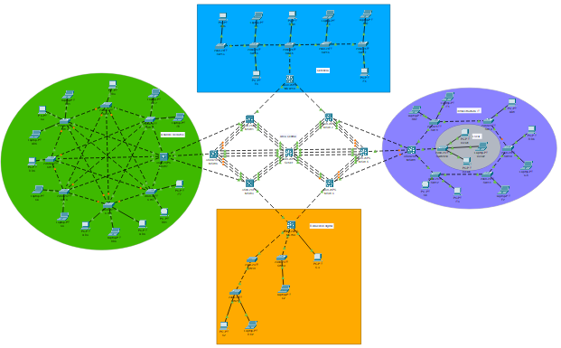
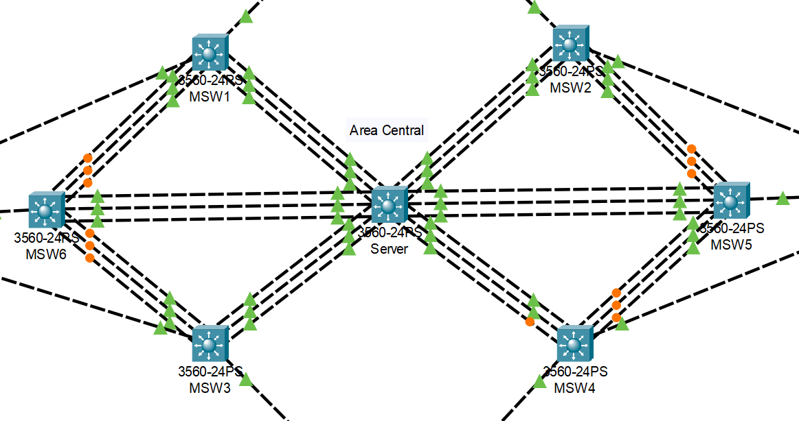
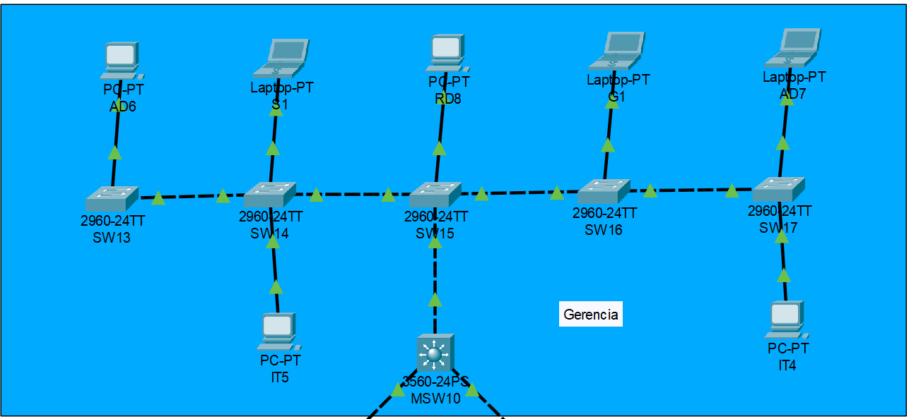
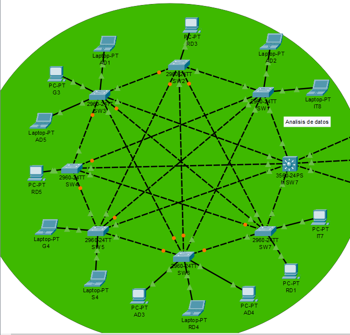
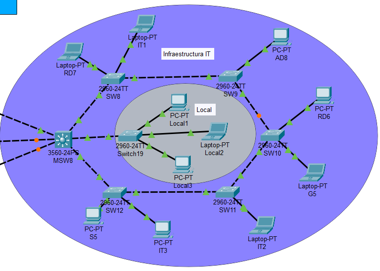
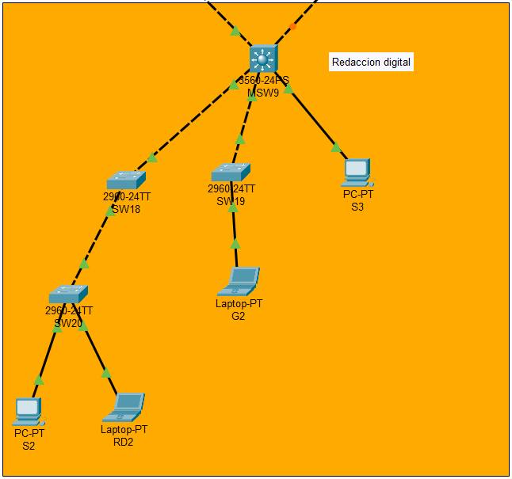

# **_Proyecto 1_**

## NetUSAC: Proyecto de Interconexión

### 2do Semestre del 2025

```js
Universidad San Carlos de Guatemala
Programador: César Rolando Hernández Palacios
Carne: 202000806
Correo: cesarhernandez0019@gmail.com
```

---

# **_Manual Tecnico_**

## **Implementacion de topologia**

Topologia completa



Implementacion de la topologia del area central



Implementacion de la topologia del area de gerencia



Implementacion de la topologia del area del Analisis de datos



Implementacion de la topologia del area del Infraestructura IT



Implementacion de la topologia del area de Redaccion digital



---

## **Comfiguraciones Implementadas**

### Configuración VLANs:

    - VLAN 16: Redacción Digital
    - VLAN 26: Análisis de Datos
    - VLAN 36: Infraestructura IT
    - VLAN 46: Seguridad
    - VLAN 56: Gerencia
    - VLAN 76: Recepcion

### Tabla de IPs - Dispositivos Finales

#### Redacción Digital (VLAN 16)

| Dispositivo | IP Asignada   |
| ----------- | ------------- |
| RD1         | 192.168.16.11 |
| RD2         | 192.168.16.12 |
| RD3         | 192.168.16.13 |
| RD4         | 192.168.16.14 |
| RD5         | 192.168.16.15 |
| RD6         | 192.168.16.16 |
| RD7         | 192.168.16.17 |
| RD8         | 192.168.16.18 |

#### Análisis de Datos (VLAN 26)

| Dispositivo | IP Asignada   |
| ----------- | ------------- |
| AD1         | 192.168.16.21 |
| AD2         | 192.168.16.22 |
| AD3         | 192.168.16.23 |
| AD4         | 192.168.16.24 |
| AD5         | 192.168.16.25 |
| AD6         | 192.168.16.26 |
| AD7         | 192.168.16.27 |
| AD8         | 192.168.16.28 |

#### Infraestructura IT (VLAN 36)

| Dispositivo | IP Asignada   |
| ----------- | ------------- |
| IT1         | 192.168.16.31 |
| IT2         | 192.168.16.32 |
| IT3         | 192.168.16.33 |
| IT4         | 192.168.16.34 |
| IT5         | 192.168.16.35 |
| IT7         | 192.168.16.37 |
| IT8         | 192.168.16.38 |

#### Seguridad (VLAN 46)

| Dispositivo | IP Asignada   |
| ----------- | ------------- |
| S1          | 192.168.16.41 |
| S2          | 192.168.16.42 |
| S3          | 192.168.16.43 |
| S4          | 192.168.16.44 |
| S5          | 192.168.16.45 |

#### Gerencia (VLAN 56)

| Dispositivo | IP Asignada   |
| ----------- | ------------- |
| G1          | 192.168.16.51 |
| G2          | 192.168.16.52 |
| G3          | 192.168.16.53 |
| G4          | 192.168.16.54 |
| G5          | 192.168.16.55 |

#### Recepción (VLAN 76)

| Dispositivo | IP Asignada   |
| ----------- | ------------- |
| Local1      | 192.168.16.71 |
| Local2      | 192.168.16.72 |
| Local3      | 192.168.16.73 |

### **Area Central**

1.  Switch SERVIDOR

    ##### Comandos de configuracion:

        # configurando vtp
        enable
        configure terminal
        hostname Server
        vtp mode server
        vtp domain C8_FIUComm
        vtp password proyecto12025

        # Creación de VLANs
        vlan 16
        name Redacción_Digital
        vlan 26
        name Análisis_de_Datos
        vlan 36
        name Infraestructura_IT
        vlan 46
        name Seguridad
        vlan 56
        name Gerencia

        #confugarcion de enlaces EtherChannel
        #LACP
        interface Port-channel 1
        interface range fastEthernet 0/16 - 18
        channel-group 1 mode active
        #Configurar interfaces trunk
        interface Port-channel 1
        switchport trunk encapsulation dot1q
        switchport mode trunk
        switchport trunk allowed vlan 16,26,36,46,56


        #LACP
        interface Port-channel 2
        interface range fastEthernet 0/4-6
        channel-group 2 mode active
        #Configurar interfaces trunk
        interface Port-channel 2
        switchport trunk encapsulation dot1q
        switchport mode trunk
        switchport trunk allowed vlan 16,26,36,46,56


        #PAGP
        interface Port-channel 3
        interface range fastEthernet 0/10 - 12
        channel-group 3 mode auto
        #Configurar interfaces trunk
        interface Port-channel 3
        switchport trunk encapsulation dot1q
        switchport mode trunk
        switchport trunk allowed vlan 16,26,36,46,56

        #PAGP
        interface Port-channel 4
        interface range fastEthernet 0/7 - 9
        channel-group 4 mode auto
        #Configurar interfaces trunk
        interface Port-channel 4
        switchport trunk encapsulation dot1q
        switchport mode trunk
        switchport trunk allowed vlan 16,26,36,46,56

        #LACP
        interface Port-channel 5
        interface range fastEthernet 0/1 - 3
        channel-group 5 mode active
        #Configurar interfaces trunk
        interface Port-channel 5
        switchport trunk encapsulation dot1q
        switchport mode trunk
        switchport trunk allowed vlan 16,26,36,46,56


        #LACP
        interface Port-channel 6
        interface range fastEthernet 0/13 - 15
        channel-group 6 mode active
        #Configurar interfaces trunk
        interface Port-channel 6
        switchport trunk encapsulation dot1q
        switchport mode trunk
        switchport trunk allowed vlan 16,26,36,46,56


        #configuracion de STP (Spanning tree protocol)
        spanning-tree mode pvst
        spanning-tree vlan 16,26,36,46,56 root primary
        do w


        #confuguracion de mensaje de bienvenida
        banner motd # Bienvenido a Area Central - FIUComm_202000806 #
        end
        write memory

2.  Switch MSW1

    ##### Comandos de configuracion:

        #configuracion de interfaces trunk
        interface range fastEthernet 0/1-8
        switchport trunk encapsulation dot1q
        switchport mode trunk
        switchport trunk allowed vlan 16,26,36,46,56

        #confugarcion de enlaces EtherChannel para MSW1
        #LACP
        interface Port-channel 1
        switchport trunk encapsulation dot1q
        switchport mode trunk
        switchport trunk allowed vlan 16,26,36,46,56
        #agregando puertos al Port-channel 1
        interface range fastEthernet 0/1-3
        channel-group 1 mode active

        #LACP
        interface Port-channel 2
        #Configurar interfaces trunk
        switchport trunk encapsulation dot1q
        switchport mode trunk
        switchport trunk allowed vlan 16,26,36,46,56
        #agregando puertos al Port-channel 2
        interface range fastEthernet 0/4-6
        channel-group 2 mode active

        #configuracion de STP (Spanning tree protocol)
        spanning-tree mode pvst
        do w

        exit

3.  Switch MSW2

    ##### Comandos de configuracion:

        #configuracion de interfaces trunk
        interface range fastEthernet 0/1-8
        switchport trunk encapsulation dot1q
        switchport mode trunk
        switchport trunk allowed vlan 16,26,36,46,56

        #confugarcion de enlaces EtherChannel para MSW2
        #LACP
        interface Port-channel 1
        #Configurar interfaces trunk
        switchport trunk encapsulation dot1q
        switchport mode trunk
        switchport trunk allowed vlan 16,26,36,46,56
        #agregando puertos al Port-channel 1
        interface range fastEthernet 0/1-3
        channel-group 1 mode active

        #LACP
        interface Port-channel 2
        #Configurar interfaces trunk
        switchport trunk encapsulation dot1q
        switchport mode trunk
        switchport trunk allowed vlan 16,26,36,46,56
        #agregando puertos al Port-channel 2
        interface range fastEthernet 0/4-6
        channel-group 2 mode active

        #configuracion de STP (Spanning tree protocol)
        spanning-tree mode pvst
        do w

        exit

4.  Switch MSW3

    ##### Comandos de configuracion:

        #configuracion de interfaces trunk
        interface range fastEthernet 0/1-8
        switchport trunk encapsulation dot1q
        switchport mode trunk
        switchport trunk allowed vlan 16,26,36,46,56

        #confugarcion de enlaces EtherChannel para MSW3
        #PAGP
        interface Port-channel 1
        #Configurar interfaces trunk
        switchport trunk encapsulation dot1q
        switchport mode trunk
        switchport trunk allowed vlan 16,26,36,46,56
        #agregando puertos al Port-channel 1
        interface range fastEthernet 0/1 - 3
        channel-group 1 mode desirable

        #PAGP
        interface Port-channel 2
        #Configurar interfaces trunk
        switchport trunk encapsulation dot1q
        switchport mode trunk
        switchport trunk allowed vlan 16,26,36,46,56
        #agregando puertos al Port-channel 2
        interface range fastEthernet 0/4 - 6
        channel-group 2 mode auto

        #configuracion de STP (Spanning tree protocol)
        spanning-tree mode pvst
        do w

        exit

5.  Switch MSW4

    ##### Comandos de configuracion:

        #configuracion de interfaces trunk
        interface range fastEthernet 0/1-8
        switchport trunk encapsulation dot1q
        switchport mode trunk
        switchport trunk allowed vlan 16,26,36,46,56

        #confugarcion de enlaces EtherChannel para MSW4
        #PAGP
        interface Port-channel 1
        #Configurar interfaces trunk
        switchport trunk encapsulation dot1q
        switchport mode trunk
        switchport trunk allowed vlan 16,26,36,46,56
        #agregando puertos al Port-channel 1
        interface range fastEthernet 0/1 - 3
        channel-group 1 mode desirable

        #PAGP
        interface Port-channel 2
        #Configurar interfaces trunk
        switchport trunk encapsulation dot1q
        switchport mode trunk
        switchport trunk allowed vlan 16,26,36,46,56
        #agregando puertos al Port-channel 2
        interface range fastEthernet 0/4 - 6
        channel-group 2 mode auto

        #configuracion de STP (Spanning tree protocol)
        spanning-tree mode pvst
        do w

        exit

6.  Switch MSW5

    ##### Comandos de configuracion:

        #configuracion de interfaces trunk
        interface range fastEthernet 0/1-10
        switchport trunk encapsulation dot1q
        switchport mode trunk
        switchport trunk allowed vlan 16,26,36,46,56


        #confugarcion de enlaces EtherChannel para MSW5
        #LACP
        interface Port-channel 1
        #Configurar interfaces trunk
        switchport trunk encapsulation dot1q
        switchport mode trunk
        switchport trunk allowed vlan 16,26,36,46,56
        #agregando puertos al Port-channel 1
        interface range fastEthernet 0/7-9
        channel-group 1 mode active

        #LACP
        interface Port-channel 2
        #Configurar interfaces trunk
        switchport trunk encapsulation dot1q
        switchport mode trunk
        switchport trunk allowed vlan 16,26,36,46,56
        #agregando puertos al Port-channel 2
        interface range fastEthernet 0/1-3
        channel-group 2 mode active

        #PAGP
        interface Port-channel 3
        #Configurar interfaces trunk
        switchport trunk encapsulation dot1q
        switchport mode trunk
        switchport trunk allowed vlan 16,26,36,46,56
        #agregando puertos al Port-channel 3
        interface range fastEthernet 0/4 - 6
        channel-group 3 mode desirable

        #configuracion de STP (Spanning tree protocol)
        spanning-tree mode pvst
        do w

        exit

7.  Switch MSW6

    ##### Comandos de configuracion:

        #configuracion de interfaces trunk
        interface range fastEthernet 0/1-10
        switchport trunk encapsulation dot1q
        switchport mode trunk
        switchport trunk allowed vlan 16,26,36,46,56


        #confugarcion de enlaces EtherChannel para MSW5
        #LACP
        interface Port-channel 1
        #Configurar interfaces trunk
        switchport trunk encapsulation dot1q
        switchport mode trunk
        switchport trunk allowed vlan 16,26,36,46,56
        #agregando puertos al Port-channel 1
        interface range fastEthernet 0/4-6
        channel-group 1 mode active

        #LACP
        interface Port-channel 2
        #Configurar interfaces trunk
        switchport trunk encapsulation dot1q
        switchport mode trunk
        switchport trunk allowed vlan 16,26,36,46,56
        #agregando puertos al Port-channel 2
        interface range fastEthernet 0/1-3
        channel-group 2 mode active

        #PAGP
        interface Port-channel 3
        #Configurar interfaces trunk
        switchport trunk encapsulation dot1q
        switchport mode trunk
        switchport trunk allowed vlan 16,26,36,46,56
        #agregando puertos al Port-channel 3
        interface range fastEthernet 0/7 - 9
        channel-group 3 mode desirable

        #configuracion de STP (Spanning tree protocol)
        spanning-tree mode pvst
        do w

        exit

### **Area de Gerencia**

1.  Switch MSW10

    ##### Comandos de configuracion:

        #configurando en modo cliente
        # configurando vtp
            enable
            configure terminal
            hostname MSW10
            vtp mode client
            vtp domain C8_FIUComm
            vtp password proyecto12025

        #configuracion de interfaces trunk este comando es para hacerlo por un rango ahi dice que del puerto 1 al 3
            interface range fastEthernet 0/1-3
            switchport trunk encapsulation dot1q
            switchport mode trunk
            switchport trunk allowed vlan 16,26,36,46,56

        #configuracion de STP (Spanning tree protocol)
            spanning-tree mode pvst
            do w

        #confuguracion de mensaje de bienvenida
            banner motd # Bienvenido a Gerencia - FIUComm_202000806 #
            end
            write memory

2.  Switch SW15

    ##### Comandos de configuracion:

        #configurando en modo cliente
        # configurando vtp
            enable
            configure terminal
            hostname SW15
            vtp mode client
            vtp domain C8_FIUComm
            vtp password proyecto12025

        #configuracion de interfaces trunk este comando es para hacerlo por un rango ahi dice que del puerto 1 al 3
            interface range fastEthernet 0/1-3
            switchport mode trunk
            switchport trunk allowed vlan 16,26,36,46,56

        #configuracion de interfaces access para respectivo equipo
        interface Fa0/4
        switchport mode access
        switchport access vlan 16


        #configuracion de STP (Spanning tree protocol)
            spanning-tree mode pvst
            do w

3.  Switch SW14

    ##### Comandos de configuracion:

        #configurando en modo cliente
        # configurando vtp
            enable
            configure terminal
            hostname SW14
            vtp mode client
            vtp domain C8_FIUComm
            vtp password proyecto12025

        #configuracion de interfaces trunk este comando es para hacerlo por un rango ahi dice que del puerto 1 al 2
        interface range fastEthernet 0/1-2
            switchport mode trunk
            switchport trunk allowed vlan 16,26,36,46,56

        #configuracion de interfaces access para respectivo equipo
        interface Fa0/3
        switchport mode access
        switchport access vlan 36

        interface Fa0/4
        switchport mode access
        switchport access vlan 46

        #configuracion de STP (Spanning tree protocol)
            spanning-tree mode pvst
            do w

4.  Switch SW13

    ##### Comandos de configuracion:

        #configurando en modo cliente
        # configurando vtp
            enable
            configure terminal
            hostname SW13
            vtp mode client
            vtp domain C8_FIUComm
            vtp password proyecto12025

        #configuracion de interfaces trunk
            interface Fa0/1
            switchport mode trunk
            switchport trunk allowed vlan 16,26,36,46,56

        #configuracion de interfaces access para respectivo equipo
        interface Fa0/2
        switchport mode access
        switchport access vlan 26

        #configuracion de STP (Spanning tree protocol)
            spanning-tree mode pvst
            do w

5.  Switch SW16

    ##### Comandos de configuracion:

        #configurando en modo cliente
        # configurando vtp
            enable
            configure terminal
            hostname SW16
            vtp mode client
            vtp domain C8_FIUComm
            vtp password proyecto12025

        #configuracion de interfaces trunk este comando es para hacerlo por un rango ahi dice que del puerto 1 al 2
            interface range fastEthernet 0/1-2
            switchport mode trunk
            switchport trunk allowed vlan 16,26,36,46,56

        #configuracion de interfaces access para respectivo equipo
        interface Fa0/3
        switchport mode access
        switchport access vlan 56

        #configuracion de STP (Spanning tree protocol)
            spanning-tree mode pvst
            do w

6.  Switch SW17

    ##### Comandos de configuracion:

        #configurando en modo cliente
        # configurando vtp
            enable
            configure terminal
            hostname SW17
            vtp mode client
            vtp domain C8_FIUComm
            vtp password proyecto12025

        #configuracion de interfaces trunk este comando es para hacerlo por un rango ahi dice que del puerto 1 al 2
            interface Fa0/1
            switchport mode trunk
            switchport trunk allowed vlan 16,26,36,46,56

        #configuracion de interfaces access para respectivo equipo
        interface Fa0/2
        switchport mode access
        switchport access vlan 36

        interface Fa0/3
        switchport mode access
        switchport access vlan 26

        #configuracion de STP (Spanning tree protocol)
            spanning-tree mode pvst
            do w

### **Area de Analisis de datos**

1.  Switch MSW7

    ##### Comandos de configuracion:

        #configurando en modo cliente
        # configurando vtp
            enable
            configure terminal
            hostname MSW7
            vtp mode client
            vtp domain C8_FIUComm
            vtp password proyecto12025

        #configuracion de interfaces trunk este comando es para hacerlo por un rango ahi dice que del puerto 1 al 8
            interface range fastEthernet 0/1-8
            switchport trunk encapsulation dot1q
            switchport mode trunk
            switchport trunk allowed vlan 16,26,36,46,56

        #confuguracion de mensaje de bienvenida
            banner motd # Bienvenido a Analisis de Datos - FIUComm_202000806 #
            end
            write memory

2.  Switch SW1

    ##### Comandos de configuracion:

        #configurando en modo cliente
        # configurando vtp
            enable
            configure terminal
            hostname SW1
            vtp mode client
            vtp domain C8_FIUComm
            vtp password proyecto12025

        #configuracion de interfaces trunk este comando es para hacerlo por un rango ahi dice que del puerto 1 al 5
            interface range fastEthernet 0/1-5
            switchport mode trunk
            switchport trunk allowed vlan 16,26,36,46,56

        #configuracion de interfaces access para respectivo equipo
        interface Fa0/6
        switchport mode access
        switchport access vlan 36

        interface Fa0/7
        switchport mode access
        switchport access vlan 26


        #configuracion de STP (Spanning tree protocol)
            spanning-tree mode pvst
            do w

3.  Switch SW2

    ##### Comandos de configuracion:

        #configurando en modo cliente
        # configurando vtp
            enable
            configure terminal
            hostname SW2
            vtp mode client
            vtp domain C8_FIUComm
            vtp password proyecto12025

        #configuracion de interfaces trunk este comando es para hacerlo por un rango ahi dice que del puerto 1 al 5
            interface range fastEthernet 0/1-5
            switchport mode trunk
            switchport trunk allowed vlan 16,26,36,46,56

        #configuracion de interfaces access para respectivo equipo
        interface Fa0/6
        switchport mode access
        switchport access vlan 16

        #configuracion de STP (Spanning tree protocol)
            spanning-tree mode pvst
            do w

4.  Switch SW3

    ##### Comandos de configuracion:

        #configurando en modo cliente
        # configurando vtp
            enable
            configure terminal
            hostname SW3
            vtp mode client
            vtp domain C8_FIUComm
            vtp password proyecto12025

        #configuracion de interfaces trunk este comando es para hacerlo por un rango ahi dice que del puerto 1 al 5
            interface range fastEthernet 0/1-5
            switchport mode trunk
            switchport trunk allowed vlan 16,26,36,46,56

        #configuracion de interfaces access para respectivo equipo
        interface Fa0/6
        switchport mode access
        switchport access vlan 26

        interface Fa0/7
        switchport mode access
        switchport access vlan 56

        interface Fa0/8
        switchport mode access
        switchport access vlan 26

        #configuracion de STP (Spanning tree protocol)
            spanning-tree mode pvst
            do w

5.  Switch SW4

    ##### Comandos de configuracion:

        #configurando en modo cliente
        # configurando vtp
            enable
            configure terminal
            hostname SW4
            vtp mode client
            vtp domain C8_FIUComm
            vtp password proyecto12025

        #configuracion de interfaces trunk este comando es para hacerlo por un rango ahi dice que del puerto 1 al 5
            interface range fastEthernet 0/1-5
            switchport mode trunk
            switchport trunk allowed vlan 16,26,36,46,56

        #configuracion de interfaces access para respectivo equipo
        interface Fa0/6
        switchport mode access
        switchport access vlan 16

        #configuracion de STP (Spanning tree protocol)
            spanning-tree mode pvst
            do w

### **Area de Infraestructura de IT**

1.  Switch MSW8

    ##### Comandos de configuracion:

        #configurando en modo cliente
        # configurando vtp
            enable
            configure terminal
            hostname MSW8
            vtp mode client
            vtp domain C8_FIUComm
            vtp password proyecto12025

        #configuracion de interfaces trunk este comando es para hacerlo por un rango ahi dice que del puerto 1 al 6
            interface range fastEthernet 0/1-6
            switchport trunk encapsulation dot1q
            switchport mode trunk
            switchport trunk allowed vlan 16,26,36,46,56

        #configuracion de STP (Spanning tree protocol)
            spanning-tree mode pvst
            do w

        #confuguracion de mensaje de bienvenida
            banner motd # Bienvenido a Infraestructura IT - FIUComm_202000806 #
            end
            write memory

2.  Switch SW8

    ##### Comandos de configuracion:

        #configurando en modo cliente
        # configurando vtp
            enable
            configure terminal
            hostname SW8
            vtp mode client
            vtp domain C8_FIUComm
            vtp password proyecto12025

        #configuracion de interfaces trunk este comando es para hacerlo por un rango ahi dice que del puerto 1 al 2
            interface range fastEthernet 0/1-2
            switchport mode trunk
            switchport trunk allowed vlan 16,26,36,46,56

        #configuracion de interfaces access para respectivo equipo
        interface Fa0/3
        switchport mode access
        switchport access vlan 16

        interface Fa0/4
        switchport mode access
        switchport access vlan 36

        #configuracion de STP (Spanning tree protocol)
            spanning-tree mode pvst
            do w

3.  Switch SW9

    ##### Comandos de configuracion:

        #configurando en modo cliente
        # configurando vtp
            enable
            configure terminal
            hostname SW9
            vtp mode client
            vtp domain C8_FIUComm
            vtp password proyecto12025

        #configuracion de interfaces trunk este comando es para hacerlo por un rango ahi dice que del puerto 1 al 2
            interface range fastEthernet 0/1-2
            switchport mode trunk
            switchport trunk allowed vlan 16,26,36,46,56

        #configuracion de interfaces access para respectivo equipo
        interface Fa0/3
        switchport mode access
        switchport access vlan 26

        #configuracion de STP (Spanning tree protocol)
            spanning-tree mode pvst
            do w

4.  Switch SW10

    ##### Comandos de configuracion:

        #configurando en modo cliente
        # configurando vtp
            enable
            configure terminal
            hostname SW10
            vtp mode client
            vtp domain C8_FIUComm
            vtp password proyecto12025

        #configuracion de interfaces trunk este comando es para hacerlo por un rango ahi dice que del puerto 1 al 2
            interface range fastEthernet 0/1-2
            switchport mode trunk
            switchport trunk allowed vlan 16,26,36,46,56

        #configuracion de interfaces access para respectivo equipo
        interface Fa0/3
        switchport mode access
        switchport access vlan 16

        interface Fa0/4
        switchport mode access
        switchport access vlan 56

        #configuracion de STP (Spanning tree protocol)
            spanning-tree mode pvst
            do w

### **Area de Redaccion Digital**

1.  Switch MSW9

    ##### Comandos de configuracion:

        #configurando en modo cliente
        # configurando vtp
            enable
            configure terminal
            hostname MSW9
            vtp mode client
            vtp domain C8_FIUComm
            vtp password proyecto12025


        #configuracion de interfaces trunk este comando es para hacerlo por un rango ahi dice que del puerto 1 al 4
            interface range fastEthernet 0/1-4
            switchport trunk encapsulation dot1q
            switchport mode trunk
            switchport trunk allowed vlan 16,26,36,46,56

        #configuracion de interfaces access para respectivo equipo
        interface Fa0/5
        switchport mode access
        switchport access vlan 46

        #configuracion de STP (Spanning tree protocol)
            spanning-tree mode pvst
            do w

        #confuguracion de mensaje de bienvenida
        banner motd # Bienvenido a Redaccion Digital - FIUComm_202000806 #
        end
        write memory

2.  Switch SW18

    ##### Comandos de configuracion:

        #configurando en modo cliente
        # configurando vtp
            enable
            configure terminal
            hostname SW18
            vtp mode client
            vtp domain C8_FIUComm
            vtp password proyecto12025

        #configuracion de interfaces trunk este comando es para hacerlo por un rango ahi dice que del puerto 1 al 2
            interface range fastEthernet 0/1-2
            switchport mode trunk
            switchport trunk allowed vlan 16,26,36,46,56

        #configuracion de STP (Spanning tree protocol)
            spanning-tree mode pvst
            do w

3.  Switch

    ##### Comandos de configuracion:

        #configurando en modo cliente
        # configurando vtp
            enable
            configure terminal
            hostname SW19
            vtp mode client
            vtp domain C8_FIUComm
            vtp password proyecto12025

        #configuracion de interfaces trunk
            interface Fa0/1
            switchport mode trunk
            switchport trunk allowed vlan 16,26,36,46,56

        #configuracion de interfaces access para respectivo equipo
        interface Fa0/2
        switchport mode access
        switchport access vlan 56

        #configuracion de STP (Spanning tree protocol)
            spanning-tree mode pvst
            do w

4.  Switch SW20

    ##### Comandos de configuracion:

        #configurando en modo cliente
        # configurando vtp
            enable
            configure terminal
            hostname SW20
            vtp mode client
            vtp domain C8_FIUComm
            vtp password proyecto12025

        #configuracion de interfaces trunk
            interface Fa0/1
            switchport mode trunk
            switchport trunk allowed vlan 16,26,36,46,56

        #configuracion de interfaces access para respectivo equipo
        interface Fa0/2
        switchport mode access
        switchport access vlan 46

        interface Fa0/3
        switchport mode access
        switchport access vlan 16

        #configuracion de STP (Spanning tree protocol)
            spanning-tree mode pvst
            do w

---
