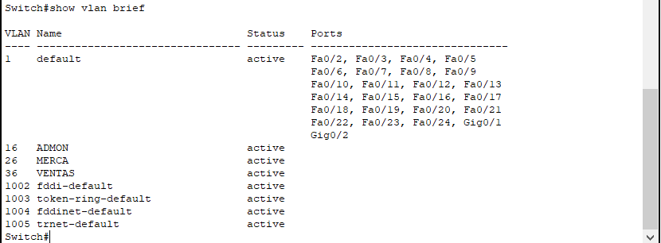
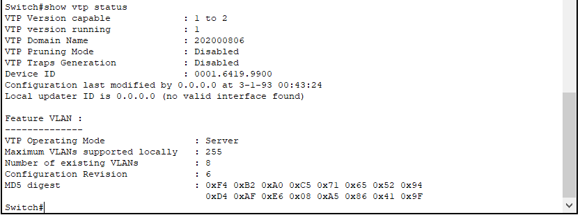
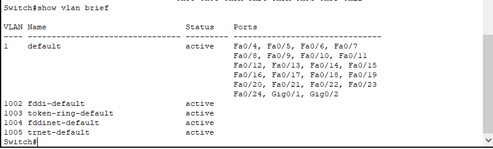
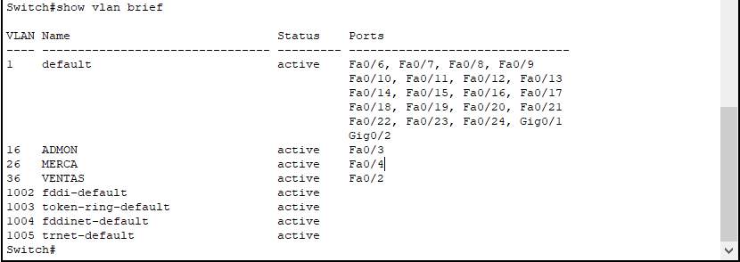
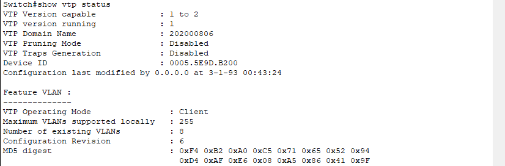
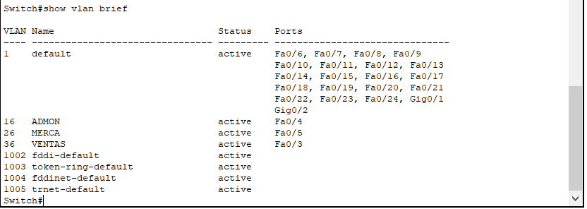
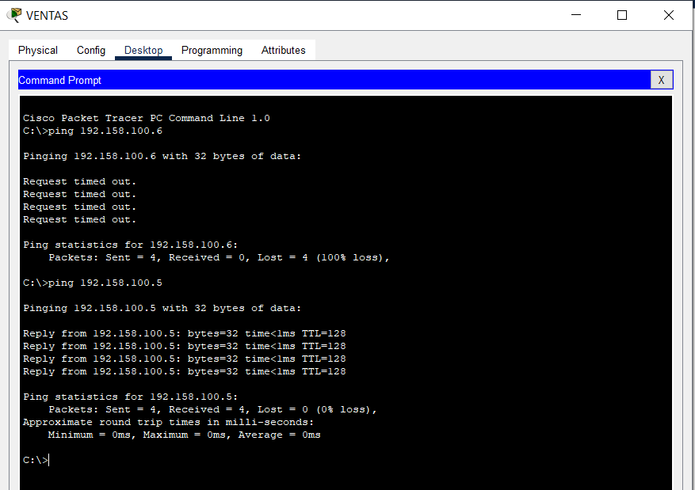
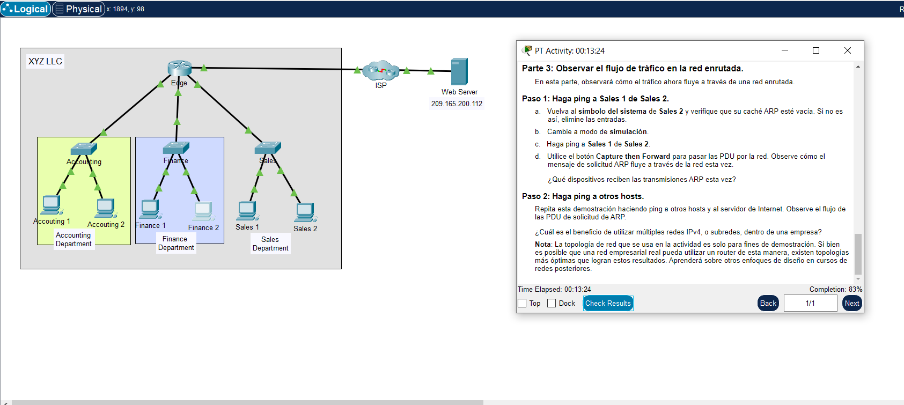
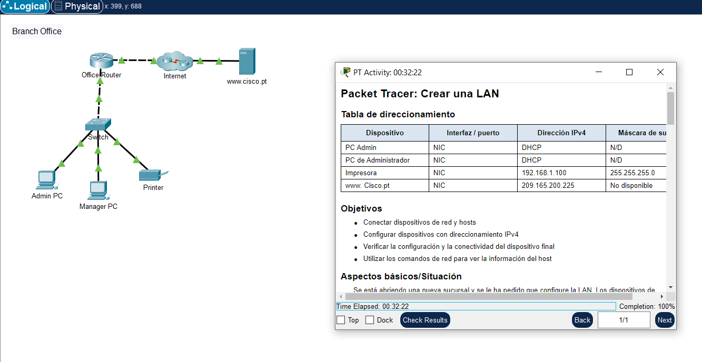
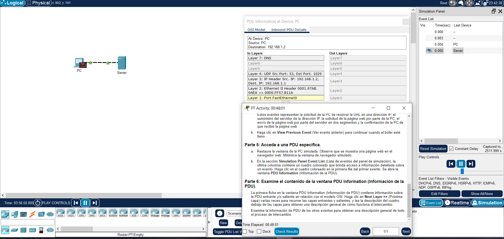

# **_Tarea 3_**

## Topología de red utilizando dispositivos de red virtuales o físicos con protocolo VTP y vlans

### 2do Semestre del 2025

```js
Universidad San Carlos de Guatemala
Programador: César Rolando Hernández Palacios
Carne: 202000806
Correo: cesarhernandez0019@gmail.com
```

---

## **_Manual_**

[Script](#script)

[Capturas](#capturas)

---

### **_Script_**

#### **_Switchs_**

1.  Configuracion vlans servidor

        # Entrar al modo de configuración global
        enable
        configure terminal

        # Configurar el dominio VTP y la contraseña
        vtp mode server
        vtp domain 202000806
        vtp password 202000806
        vtp version 2

        # Crear VLANs
        vlan 16
        name ADMON
        exit
        vlan 26
        name MERCA
        exit
        vlan 36
        name VENTAS
        exit

        # Configurar interface trunk
        interface FastEthernet0/1
        switchport mode trunk
        switchport trunk allowed vlan 16,26,36
        exit

2.  Configuracion transparente

        # Entrar al modo de configuración global
        enable
        configure terminal

        # Configurar interface trunk
        interface Fa0/1
        switchport mode trunk
        switchport trunk allowed vlan 16,26,36
        exit

        interface Fa0/2
        switchport mode trunk
        switchport trunk allowed vlan 16,26,36
        exit

        interface Fa0/3
        switchport mode trunk
        switchport trunk allowed vlan 16,26,36
        exit

3.  Configuración de los Cliente 01 y 02

    1.  Cliente 1

            # Entrar al modo de configuración global
            enable
            configure terminal

            # Configurar el dominio VTP y la contraseña
            vtp mode server
            vtp domain 202000806
            vtp password 202000806
            vtp version 2

            #Configuración de los Enlaces Trunk y acceso
            interface FastEthernet0/5
            switchport mode trunk
            switchport trunk allowed vlan 16,26,36
            exit

            interface FastEthernet0/1
            switchport mode trunk
            switchport trunk allowed vlan 16,26,36
            exit

            interface FastEthernet0/2
            switchport mode access
            switchport access vlan 36
            exit

            interface FastEthernet0/3
            switchport mode access
            switchport access vlan 16
            exit

            interface FastEthernet0/4
            switchport mode access
            switchport access vlan 26
            exit

    2.  Cliente 2

            # Entrar al modo de configuración global
            enable
            configure terminal

            # Configurar el dominio VTP y la contraseña
            vtp mode server
            vtp domain 202000806
            vtp password 202000806
            vtp version 2

            #Configuración de los Enlaces Trunk y acceso
            interface FastEthernet0/1
            switchport mode trunk
            switchport trunk allowed vlan 16,26,36
            exit

            interface FastEthernet0/2
            switchport mode trunk
            switchport trunk allowed vlan 16,26,36
            exit

            interface FastEthernet0/3
            switchport mode access
            switchport access vlan 36
            exit

            interface FastEthernet0/4
            switchport mode access
            switchport access vlan 16
            exit

            interface FastEthernet0/5
            switchport mode access
            switchport access vlan 26
            exit

4.  Comando para verificación de la Configuración

    1.  Verificar las VLANs creadas en todos los switches:

            show vlan brief

    2.  Verificar el estado del VTP:

            show vtp status

---

### **_Capturas_**

#### **_Servidor_**





#### **_Transparente_**




#### **_Cliente 1_**





#### **_Cliente 2_**




#### **_Pruebas ping_**



#### **_Evidencias de las actividades 14.3.3, 14.3.4 y 16.1.5_**

14.3.3



14.3.4



16.1.5



---
